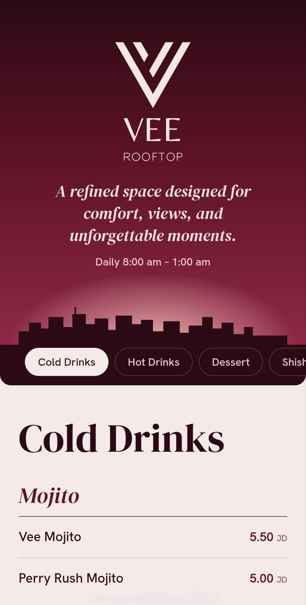
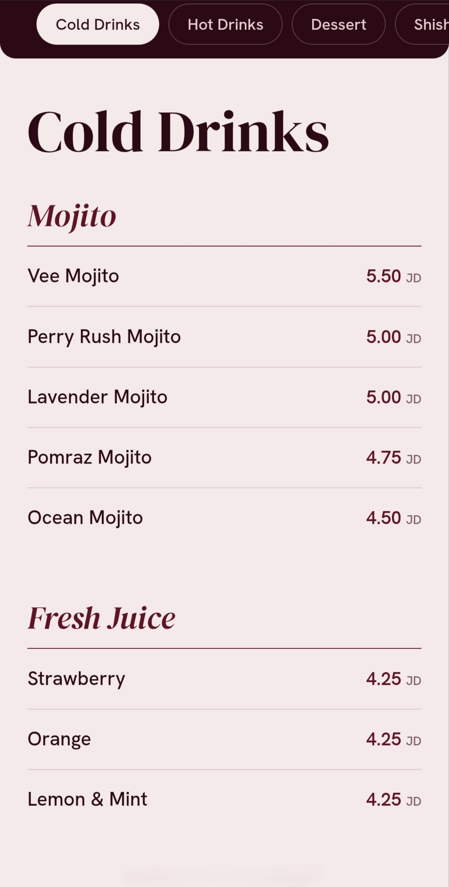
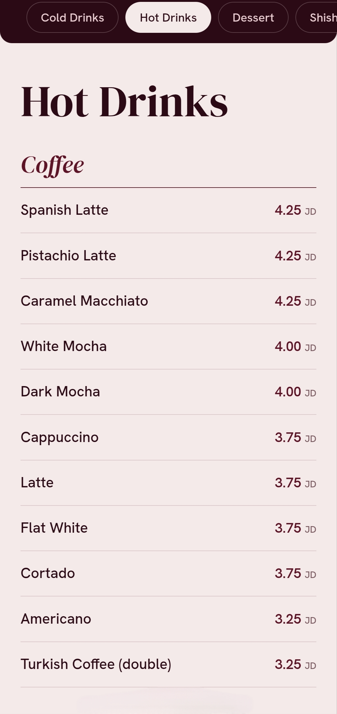
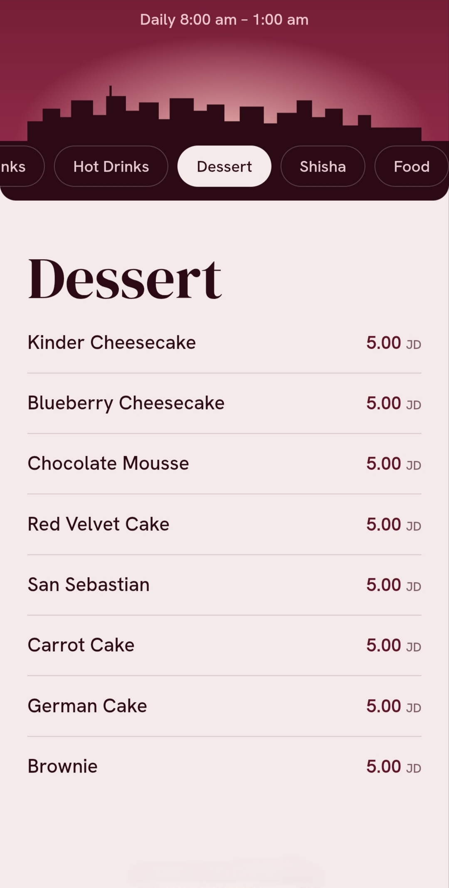
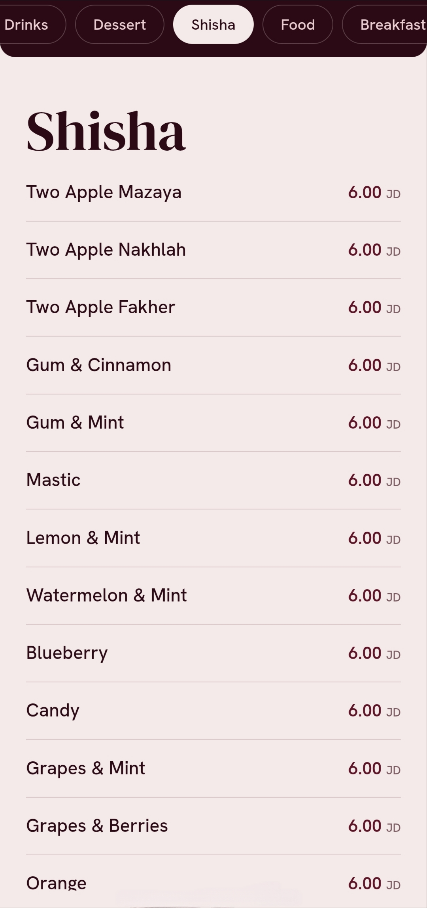
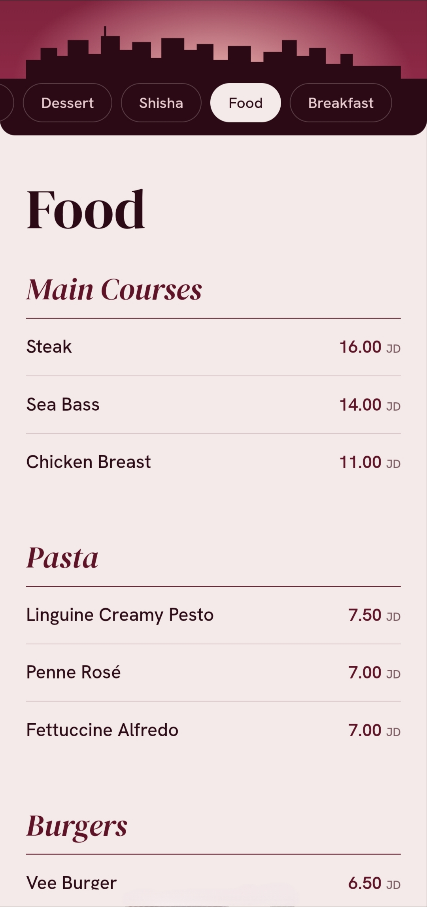
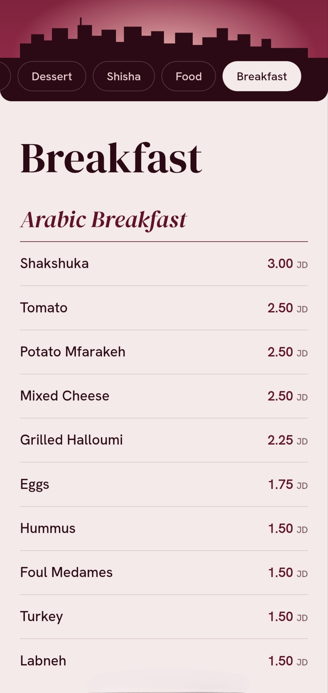
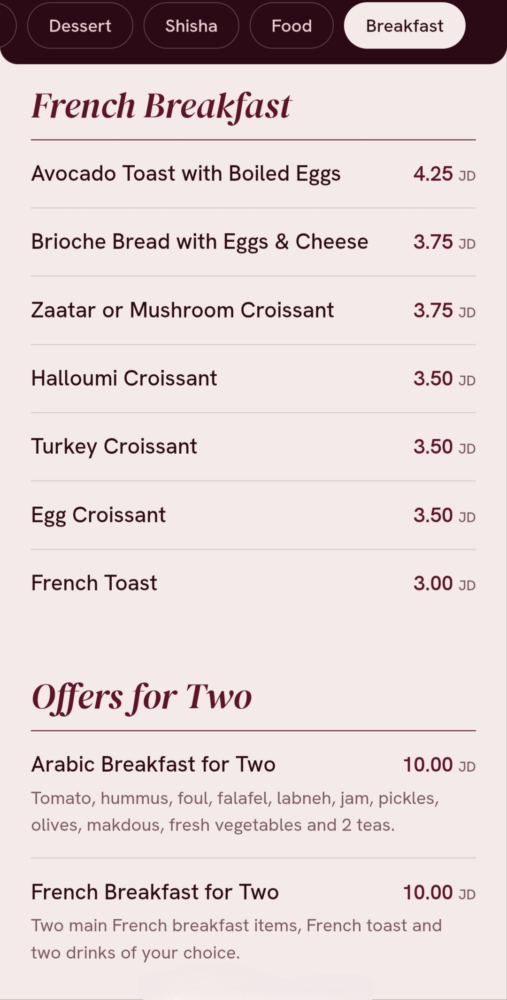

# Vee Rooftop Menu

Mobile-first online menu for Vee Rooftop (Amman, Jordan). It replaces a PDF menu opened through a QR code.

Live: https://vee-menu.netlify.app/

## Screenshots

<p>
  
  
  
  
</p>
<p>
  
  
  
  
</p>

## How it works

- Single static page (`index.html`): HTML, CSS and vanilla JavaScript. No framework, no dependencies.
- The menu is edited in a Google Sheet, published as CSV. The page fetches it on every load.
- If the sheet cannot be fetched, the page shows the last good copy from the browser cache, then the built-in menu stored in `index.html`.
- A GitHub Action refreshes the built-in menu from the sheet every hour and commits only when it changed. Netlify deploys from the repository, so a deploy happens only on a real menu change.

## Sheet format

One row per item. Header row:

| tab | category | name | price | description |
|---|---|---|---|---|

- `tab`: top-level section (for example Cold Drinks). Tab order follows row order.
- `category`: group inside a tab. Leave empty to use the tab name.
- `price`: one number, in JD. Leave empty to show no price.
- `description`: optional.

## Files

| File | Purpose |
|---|---|
| `index.html` | The page, including the built-in fallback menu |
| `update-menu.js` | Rewrites the built-in menu from the sheet (Node 18+, no packages) |
| `.github/workflows/update-menu.yml` | Runs `update-menu.js` hourly and commits changes |

## Update the built-in menu manually

```
node update-menu.js              # fetch the published sheet
node update-menu.js menu.csv     # use a local CSV file
node update-menu.js --dry-run    # show what would change, write nothing
```

## Stack

HTML, CSS, JavaScript, Google Sheets (CSV), GitHub Actions, Netlify.
